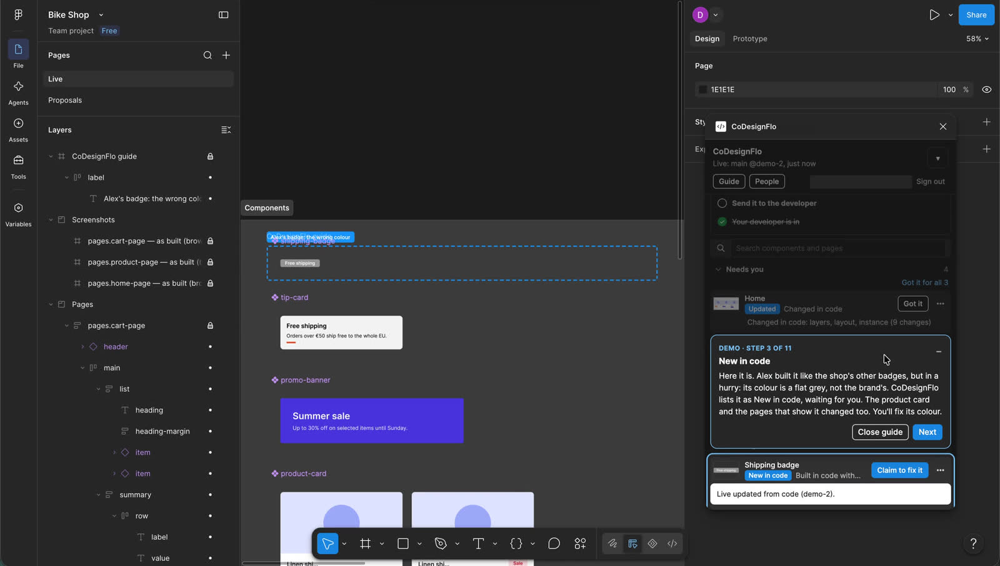
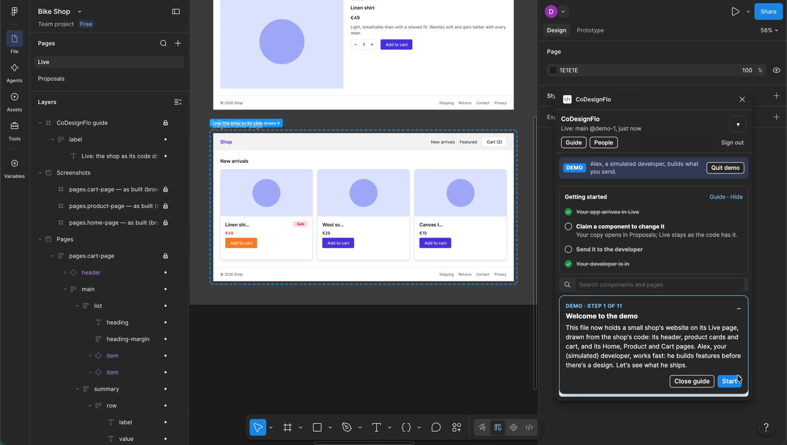
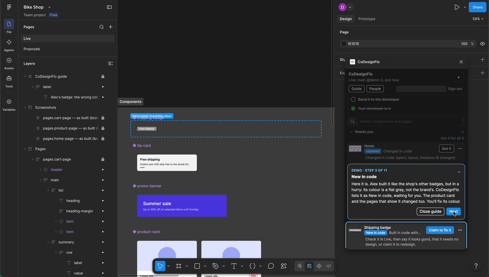
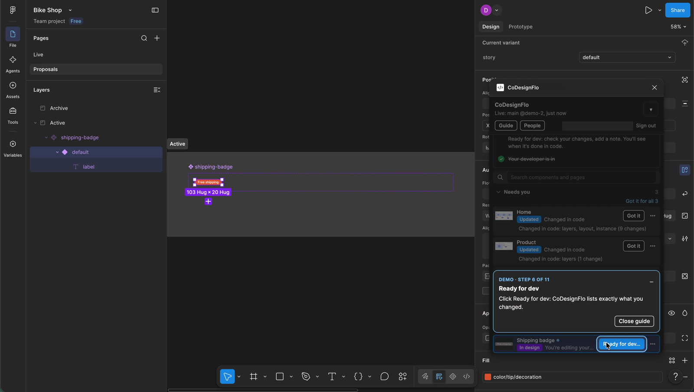
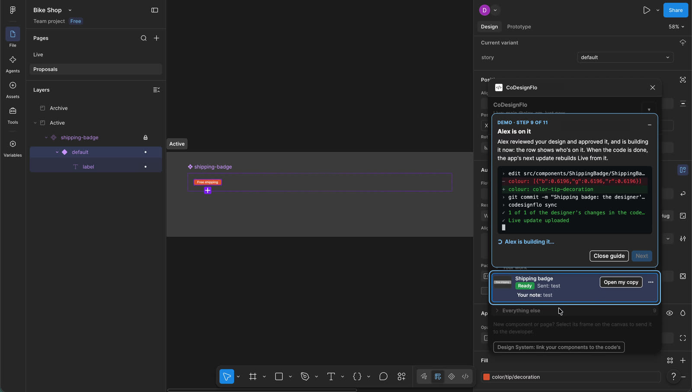
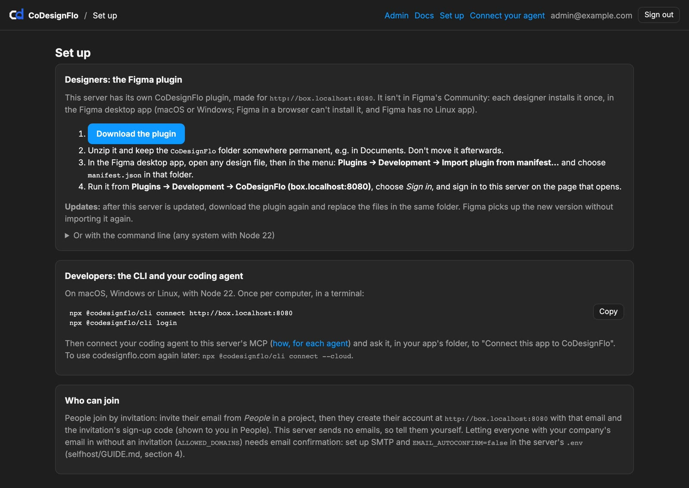

# CoDesignFlo

**Your app in Figma. Your designs in code.**

[](https://codesignflo.com/demo.mp4)

<p align="center"><a href="https://codesignflo.com/demo.mp4">▶ Watch the 90-second demo</a> · <a href="https://codesignflo.com">codesignflo.com</a> · <a href="https://codesignflo.com/#/docs/developers">Docs</a></p>

Developers using AI ship faster than anyone can design. CoDesignFlo lets them, and keeps design in the loop:

- **Your app, in Figma.** Each page and component the developers build is drawn in the designer's Figma file, on a
  page called **Live**, straight from the code. It stays up to date as they ship.
- **Fix the look.** The designer claims any page or component and changes it like any Figma design.
- **The code follows.** The developers' coding agent (Claude Code, Cursor, VS Code, Codex, Gemini CLI, Windsurf…)
  gets the exact changes over MCP, builds them, and Live shows the result. The proposal closes by itself once the
  code matches.

Think of it as pull requests for design: the designer proposes, the developer reviews and builds, and nobody has to
be online at the same time.

## Contents

- [How it works](#how-it-works)
- [What you get](#what-you-get)
- [Getting started](#getting-started) (hosted, or [on your own server](#on-your-own-server))
- [Working with your coding agent](#working-with-your-coding-agent)
- [Stories for Live](#stories-for-live)
- [Architecture](#architecture)
- [What's in this repository](#whats-in-this-repository)
- [Developing](#developing)
- [Licenses](#licenses)

## How it works

**1. Your app arrives in Figma.** The developer's machine renders the app's Storybook in a headless browser, reads
what the browser drew (layout, text, styles, images) and compiles it into Figma layers: components with their
variants, and full pages. The plugin applies that to the **Live** page the next time the file is open. Every commit
on the Live branch can update it.



**2. New in code, waiting for the designer.** When a developer ships something, the plugin lists it under *Needs
you*: here a shipping badge built in a hurry, in a flat grey instead of the brand's colour. The designer checks it in
Live and says it looks good, that it needs no design, or claims it to redesign it.



**3. The designer fixes it and sends it.** Claiming opens the designer's own copy on the **Proposals** page; Live
keeps showing what the code draws. They change the copy like any Figma design and choose **Ready for dev** with a
note. CoDesignFlo compares the copy with the version they started from and lists exactly what changed: properties,
text, layers, sizes, and colours as the app's design tokens.



**4. The coding agent builds it.** The developer's agent gets the change over MCP as implementation instructions,
edits the code its own way, commits and syncs. Every sync checks each open design against the code ("1 of 1 of the
designer's changes in the code", then "looks done"). When Live, rebuilt from the code, matches the design, the
proposal closes and the designer is told.



```
 your code ──sync──▶ CoDesignFlo ──plugin──▶ Figma "Live"
     ▲                                          │ claim, edit, send
     └──── agent builds it ◀── proposal ◀───────┘
```

## What you get

- **Live**: the app's components (each story a variant) and pages (`Pages/…` stories), drawn from the code with
  auto-layout, text styles and the app's tokens as Figma variables. Each page has a screenshot of what the browser
  drew next to it; a page built on the designer's own design shows how close the code comes to it.
- **Proposals**: claim, edit, send, take back. When the designer's copy and the code both changed meanwhile, both
  sides see it, with the choices to settle it.
- **New components and pages**: the designer draws something new (one frame or several) and sends it; the developer
  builds it, and it joins Live.
- **Review before building**: the developer (with their agent) goes through what the designer sent one design at a
  time, approves it, asks the designer a question, or sends it back.
- **Branch previews**: on a feature branch, a sync can show the designer what the branch changes, in its own section
  of the Live page, before it's merged.
- **Design system**: the designer links their Figma library's components to the code's; where they differ, they take
  the code's version or send theirs as a proposal.
- **The plugin panel** in Figma: what needs the designer, their work in progress, the history of every component, the
  people in the project and a guided demo.
- **The web app**: projects, the activity of each one, Live's state, people and settings, and how to connect each
  coding agent.
- **Notifications**: emails for what someone has to act on (a design to build, a question to answer), and the
  project's Slack channel for everything.
- **Roles**: designers, developers and admins. Each side's decisions are recorded only from their own side.

## Getting started

### Hosted, at codesignflo.com

Nothing to run. Developers are always free; designers send their first 5 designs free, then pay per seat.

**Designers.** [Download the CoDesignFlo plugin](https://codesignflo.com/plugin.zip), unzip it somewhere it can
stay, and in the Figma desktop app choose *Plugins → Development → Import plugin from manifest…* with its
`manifest.json`. Open your team's file, run it, sign in and choose *Start a project for this file*. To look around first, open an empty file and choose *Try a demo*:
a sample app and a simulated developer, with a step-by-step guide. Invite your developer from *People*.

**Developers.** Add CoDesignFlo's MCP server to your coding agent once. With Claude Code:

```sh
claude mcp add --transport http --scope user codesignflo https://codesignflo.vercel.app/mcp
```

Run `/mcp`, choose `codesignflo` and sign in. Other agents: [codesignflo.com → Connect your agent](https://codesignflo.com/#/connect).
Then, in your app's folder, ask your agent:

> Connect this app to CoDesignFlo

It identifies the repository, asks which branch should update Live, writes `.codesignflo/config.json` (commit it)
and offers to invite your designer.

**Requirements:**

- A React app in a git repository, with Storybook and stories for its components (and `Pages/…` stories for pages)
- Node.js 22 or newer on the developer's machine
- The Figma desktop app for designers (any Figma plan, including the free one)
- Optional: a DTCG design-tokens file, so Live binds colours and sizes to your tokens

### On your own server

Run the whole thing for your team with Docker, on a developer's laptop, an office computer or a small cloud server:
no billing, no limits, email sign-in. Designers and developers on different computers work through it the same way.

```sh
cd selfhost
cp .env.example .env               # set PUBLIC_URL to the address your team will use
node scripts/generate-keys.mjs     # secrets, keys and the setup code for the first account
docker compose pull                # the ready-made server image, ghcr.io/orkestralai/codesignflo-server
docker compose up -d
```

Open `PUBLIC_URL`, create the first account with the setup code (it becomes the admin) and open **Set up**: each
designer downloads the Figma plugin made for your server, and each developer connects the CLI and their agent to it.



The full guide, from choosing where it runs to HTTPS, emails, backups and updates, is in
[selfhost/GUIDE.md](selfhost/GUIDE.md).

## Working with your coding agent

You rarely run anything by hand: the agent uses CoDesignFlo's MCP server and runs the CLI (`npx @codesignflo/cli`)
for you. These prompts cover the day-to-day work:

| Say | What happens |
|---|---|
| "Connect this app to CoDesignFlo" | Sets the app up, or joins the project a designer started and invited you to |
| "sync" | Storybook is rendered and Live updated; open designs are checked against the code |
| "what did the designer send?" | What waits on you, and how Live stands |
| "review the designs with me" | One design at a time, with a review brief; your decision is recorded |
| "build the approved designs" | Each design is implemented, committed and synced until it looks done |
| "update Live on every commit" | A git hook syncs after each commit on the Live branch |
| "which components have no story?" | Stories to add, so everything shows in Live |

The MCP server's tools: `status`, `sync`, `get_proposal`, `review_queue`, `record_review`, `start_building`,
`ask_designer`, `resolve`, `wait_for_designer`, `pair_design`, `missing_stories`, `init`, `set_live_branch`,
`set_build_mode`, `auto_update`, `invite`, `resend_invitation`, `people` and `report_issue`; and its prompts:
`set_up`, `review_designs`, `implement_design` and `cover_components`.

Everything also works from a terminal: `npx @codesignflo/cli login`, `init`, `sync`, `status`, `proposal`, `ask`,
`resolve`, `verify`, `invite`, `hook install`… The full list is in [packages/cli](packages/cli#using-it-from-a-terminal).

## Stories for Live

Each story group becomes a component in Live, and each story one of its variants. Stories titled `Pages/…` become
full pages. Live renders each story at its Storybook viewport (or 1200×900), with a fixed clock (1 January 2026).
A story can tune how it's drawn:

```ts
export const Dashboard = {
  parameters: {
    codesignflo: {
      size: { width: 1440, height: 900 }, // the frame size in Live
      fullHeight: true,                   // an app shell 100vh tall whose panel scrolls
      date: "2026-03-01",                 // for fixtures with real dates
    },
  },
};
```

## Architecture

```
 Developer's machine                    CoDesignFlo service                   Designer's Figma
 ───────────────────                    ───────────────────                   ────────────────
 coding agent ──MCP──────────────────▶  MCP server + API      ◀──────────────  Figma plugin
 CLI (npx @codesignflo/cli)             Postgres (Supabase)                    (Live, Proposals,
   Storybook → headless Chromium        Auth, Storage, Realtime                 the panel)
   → Figma layers (engine) ──upload──▶  web app, notifications
```

- **The CLI** (`packages/cli`) renders Storybook with Playwright on the developer's machine, compiles what the
  browser drew into Figma layers with the engine, uploads the update and checks open designs against the code. It
  is also an MCP server over stdio (`codesignflo mcp`).
- **The engine** (`packages/core`) holds what both sides share: the Figma layer model, the compiler from rendered
  DOM to layers, the comparison of a design with its base version, and the instructions a design becomes.
- **The Figma plugin** (`packages/plugin`) applies Live updates, keeps the designer's copies on the Proposals page,
  works out what changed and sends it, and shows the panel.
- **The service** (`service`) is Postgres with row-level security (Supabase), an MCP server and API (Node), and the
  web app. Everything the plugin, the agent and the web app do goes through it, so nobody has to be online at the
  same time; Realtime tells the plugin and the web app when something changed.

**What's uploaded.** Your source code stays on the developer's machine. Only what Live needs is uploaded: the
compiled Figma layers and images of what your stories draw, the designer's proposals, and the project's history.

## What's in this repository

| Folder | What it is | License |
|---|---|---|
| [`packages/plugin`](packages/plugin) | The Figma plugin | MIT |
| [`packages/cli`](packages/cli) | The command-line tool and local MCP server (npm [`@codesignflo/cli`](https://www.npmjs.com/package/@codesignflo/cli)) | MIT |
| [`packages/core`](packages/core) | The engine both use: drawing the app in Figma, comparing designs with the code, building the changes | MIT |
| [`service`](service) | The service: database (Supabase migrations), MCP server and API, the web app | FSL-1.1-ALv2 |
| [`selfhost`](selfhost) | Everything to run your own server with Docker | FSL-1.1-ALv2 |
| [`examples/demo-app`](examples/demo-app) | A small React + Storybook shop to try it on | MIT |

## Developing

Needs Node 22, pnpm 10, and Docker for the service's local database.

```sh
pnpm install
pnpm typecheck
pnpm lint
pnpm test                       # plugin, CLI and engine
pnpm build

pnpm -C service db:start        # a local Supabase stack (Docker) with every migration
pnpm -C service test            # the service's tests, against it
```

- **The plugin**: `pnpm -C packages/plugin build`, then in the Figma desktop app *Plugins → Development → Import
  plugin from manifest…* with `packages/plugin/manifest.json`. A development build talks to the local service.
- **The CLI**: `node packages/cli/dist/main.js <command>` after `pnpm build`.
- **The demo app**: `examples/demo-app` (`pnpm -C examples/demo-app storybook`) is a good first app to sync.

Security issues: please see [SECURITY.md](SECURITY.md), not the issue tracker. Contributions:
[CONTRIBUTING.md](CONTRIBUTING.md).

## Licenses

The plugin, CLI, engine and demo app are MIT. The service and the self-hosting setup are under the Functional Source
License (FSL-1.1-ALv2): free for your own use, including running it for your team or your clients; not for offering
a competing service. Each release becomes Apache 2.0 two years after it's published. Details in
[LICENSE.md](LICENSE.md); third-party code and fonts in [THIRD_PARTY.md](THIRD_PARTY.md).

Made by [OrkestralAI](https://orkestralai.com). The hosted service is at [codesignflo.com](https://codesignflo.com).
